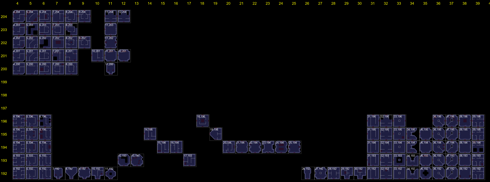

# DG Utils

A shared library for Dungeoneering plugins on the RuneScape 3 plugin API. It reads the floor map into a room tree and exposes party member positions, held keys, gatestone positions and the type of each room (base, boss, puzzle). It has no UI of its own.

DG Utils does nothing visible by itself. It is a dependency for other Dungeoneering plugins, so they can share one tested reader of the floor instead of each scraping the map interface.

## Using it from a plugin

Add DG Utils to the required dependencies in the plugin manifest and call the functions through the variable named there:

```json
"requiredDependencies": { "DgUtils": <mod.io id> }
```

```lua
if DgUtils.InDungeon() then
    local map = DgUtils.GetMap()
    for cell, room in pairs(map.rooms) do
        print(cell, DgUtils.GetRoomTypeAt(cell), room.opened)
    end
end
```

No permissions are required. Everything is read from the game's own map interface and variables; nothing is sent anywhere.

## API

| Function | Returns | Description |
|---|---|---|
| `InDungeon()` | boolean | True while the player is on a Dungeoneering floor. |
| `GetParty()` | `{ { slot, name, cell }, ... }` | One entry per party member. slot is 1 to 5, name is the display name, cell is the map cell of the member's pip or nil outside a dungeon. |
| `GetFloorNumber()` | integer 1 to 60, or nil | The party's current floor; nil when not in a party. |
| `GetTheme()` | `"Frozen" \| "Abandoned 1" \| "Furnished" \| "Abandoned 2" \| "Occult" \| "Warped"`, or nil | The current floor's theme; nil when not in a party. |
| `GetComplexity()` | 1 or 2, or nil | 1 for low, 2 for high; nil when not in a party. |
| `GetKeys()` | `{ number, ... }` | Key numbers (1 to 64) the player holds. Same numbers a key door's blocker carries. |
| `KeyName[number]` | string | Display name of a key number, e.g. 41 is Purple triangle. |
| `GetGatestones()` | `{ GATE_GREEN, GATE_RED, GATE_GROUP }` | Cell of each gatestone; a stone that is not placed is nil. |
| `GetRoomTemplateAt(cell)` | `{ column, row }`, or nil | The template room the cell was built from; nil outside a dungeon or off the floor. |
| `GetRoomTypeAt(cell)` | `"BASE" \| "BOSS" \| "NORMAL" \| "PUZZLE_*"`, or nil | The puzzle names are listed in enums.lua. Only trustworthy for cells that exist in the map's rooms. |
| `GetMap()` | map, see below | The floor as a tree of rooms rooted at the base. Always returns the same table. |

### GetMap()

```lua
{ seed, version, root, boss, rooms = { [cell] = room } }

room = {
    cell, col, row,
    opened, openedAt, exits,
    blocker = { type, value },
    parent, north, east, south, west,
}
```

| Field | Type | Description |
|---|---|---|
| `seed` | integer | The floor seed; 0 outside a floor. |
| `version` | integer | Increments on any change to the map. |
| `root` | room or nil | The base. |
| `boss` | room or nil | The boss room, once it has been opened. |
| `rooms` | `{ [cell] = room }` | Every room seen so far, keyed by cell. |
| `cell` | integer 0 to 63 | Row times 8 plus column, counted from the south-west corner of the map. |
| `col`, `row` | integer 0 to 7 | The cell's column and row. |
| `opened` | boolean | Whether the room has been opened. |
| `openedAt` | integer seconds, or nil | Floor time when the room was opened; nil if it was already open when the plugin started reading. |
| `exits` | `{ "north" \| "east" \| "south" \| "west", ... }`, or nil | Directions an opened room has doors in; nil until opened. |
| `blocker` | `{ type = "none" \| "key" \| "skill", value }`, or nil | What blocked the door into this room. value is the key number or the SkillType; nil if the room was already open when the plugin started reading. |
| `parent` | room or nil | The neighbor on the way back to the base; nil for the base. |
| `north`, `east`, `south`, `west` | room or nil | The neighboring rooms; nil means no door. |

The table is shared and live: keep a reference and read the version field. It must not be modified.

## How room types work

Every room on a floor is copied from a template area of the game world. The engine reports the template position of any room, and the template area is laid out by room type:

- rows 312–347: the base (column 7) and the boss rooms (one column per boss)
- rows 229–311: puzzle rooms, one column per puzzle; column 11 is the theme-specific puzzle
- rows up to 228: normal rooms, one identical block per theme (Frozen from row 120, Abandoned 144, Furnished 168, Occult 192, Warped 216)

The picture below is the normal-room block with each room labelled by its template column and row, in Occult numbering.



## Files

`main.lua` is the public API.

`mapreader.lua` reads the map interface into the room tree, and the player pips and gatestones.

`dungeon.lua` is in-dungeon detection and room templates.

`party.lua` is party members, floor, theme and complexity.

`keys.lua` is held keys.

`enums.lua` is key names, skill sprites and puzzle columns.

## Contact

Email: Skerf73@gmail.com, or @Skerf on Discord.
